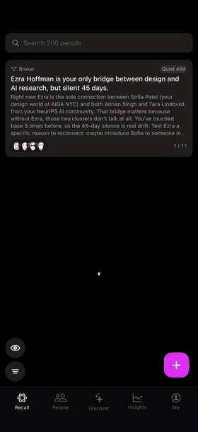
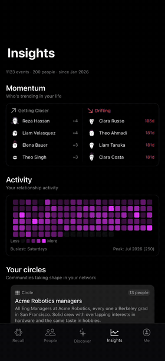
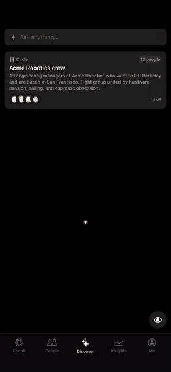
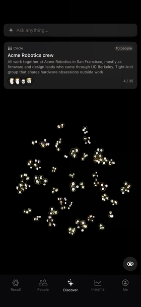
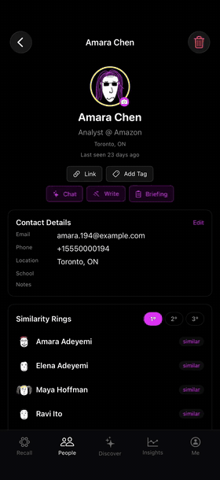
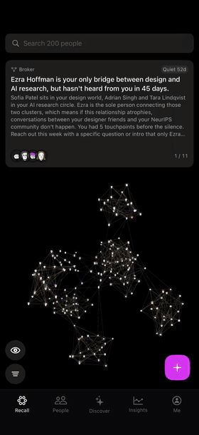
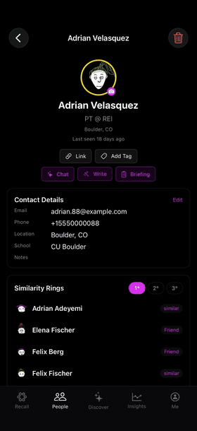
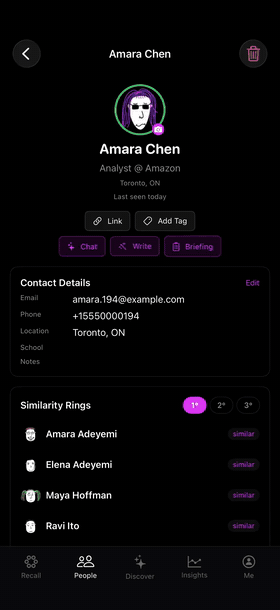

<div align="center">


# Recall

**Your network already knows.**
Recall maps every **relationship** you have, then tells you what it sees.

The **bridges**, the **patterns**, the **people** going quiet.

<a href="https://recallbio.app"></a>
</div>


<table>
  <tr>
    <td align="center" width="25%"><br/><b>3D graph</b><br/><sub>Your network as a living map; bridges and quiet ties flagged</sub></td>
    <td align="center" width="25%"><br/><b>Insights</b><br/><sub>Relationship momentum over an activity heatmap</sub></td>
    <td align="center" width="25%"><br/><b>Discover</b><br/><sub>Communities detected and lit up on the graph</sub></td>
    <td align="center" width="25%"><br/><b>Ask</b><br/><sub>"Who do I know in biotech?" answered live</sub></td>
  </tr>
  <tr>
    <td align="center"><br/><b>Biographies</b><br/><sub>A story per person, rewritten as events land</sub></td>
    <td align="center"><br/><b>Voice capture</b><br/><sub>Speak a memory; facts are extracted</sub></td>
    <td align="center"><br/><b>Drafts &amp; briefings</b><br/><sub>Messages in your tone, pre-meeting summaries</sub></td>
    <td align="center"><br/><b>Persona chat</b><br/><sub>Talk to a profile, grounded in its timeline</sub></td>
  </tr>
</table>

<div align="center">

</div>


## Status

Live on the App Store. No longer under active development. Source is private; this repo is the public face of it.

Recall was my first app taken end to end, solo: idea → backend → iOS → infra → App Store → push → payments.

## Under the hood

```
iOS (SwiftUI, iOS 26)                     Backend (FastAPI, async)              Data
┌──────────────────────────┐   REST/SSE   ┌─────────────────────────────┐      ┌──────────────────┐
│ 3D graph (WebView+THREE) │ ───────────▶ │ feature packages            │ ───▶ │ Neo4j            │
│ @Observable stores       │              │ LangGraph agents            │      │ graph + vectors  │
│ APIClient / SSEClient    │ ◀─────────── │ SAQ worker (Redis queue)    │ ───▶ │ Redis            │
└──────────────────────────┘    APNs      └─────────────────────────────┘      └──────────────────┘
                                                      │
                                                      ▼
                                       GPT-5 · Claude Haiku · embeddings
```

**Request path (every call, REST or streaming)**

```
View ─▶ Store ─▶ Service ─▶ APIClient / SSEClient ─▶ FastAPI
         │                    │
         │                    └─ 401 → single-flight token refresh → retry once
         └─ caches, dedups in-flight loads, swallows cancellation
```

**Import pipeline (off the request path)**

```
upload ─▶ enqueue ─▶ worker: upsert ─▶ hubs ─▶ embeddings ─▶ KNN ─▶ clustering ─▶ summaries ─▶ push "ready"
                     200 contacts in ~15 s · biographies written lazily on first open
```

**Backend layout: by feature, not by layer**

```
backend/
├── core/            auth, llm routing, rate limits, AI budget, registry
├── contacts/        router · schemas · service · repository
├── discovery/       clustering + search agent
├── biography/       event log → narrative synthesis
├── chat/  assist/   streaming chat, drafts, briefings
├── imports/         any-format contact import (vcf, csv, LinkedIn)
├── calendar_sync/   Google Calendar meetings
└── push/            APNs: import done, digest, birthday, reminder
```

**Stack**

| Layer | Tech |
| --- | --- |
| iOS | SwiftUI, Observation, THREE.js + 3d-force-graph (Vite single-file bundle), StoreKit via RevenueCat, APNs |
| Backend | Python, FastAPI, LangGraph, SAQ, structlog, uv, ruff |
| Data | Neo4j (graph + vector index), Redis |
| AI | GPT-5 (extraction, agents), Claude Haiku (biographies, chat, classification), OpenAI embeddings |
| Infra | AWS (EC2 t4g, Secrets Manager, ECR), Terraform, Docker Compose, Caddy, GitHub Actions with OIDC |

## Engineering highlights

- **Fact-first beats vector search on sparse data.** Tested on a real 243-connection LinkedIn export: every name the fact-first retrieval returned was true (17/17), while vector search filled every slot and invented 55 people with no evidence behind them. Vectors were demoted to clustering and similarity.
- **Refuse what the data can't answer.** A capability registry tells the query parser which signals exist; it refused 32 of 32 unanswerable questions without naming anyone.
- **Capacity measured, not guessed.** Load-tested on prod: one 2-vCPU box serves the read profile at 6.8 rps, about 2,800 DAU of headroom by the demand model.
- **Model routing by workload.** Frontier model only where reasoning matters; Haiku with prompt caching for output-heavy chat and biographies.

## Lessons worth keeping

**1. Distribution beats building.** Marketing and ASO belong at the start, not after launch. The levers I mapped, cheapest first:

```
ASO (free, slow)
├── Title 30 · Subtitle 30 · Keywords 100 ─ the only indexed text; description is not indexed
├── Situation terms over head terms ─ "warm intro", "referral tracker", not "crm"
├── Extra keyword slots via localizations
└── Keyword/subtitle changes ship only with a version submission
App Store Connect (free)
├── Custom Product Pages ─ one per audience (job search, hiring, fundraising)
├── Product Page Optimization ─ A/B icon and screenshots
└── In-App Events ─ seasonal hooks ("New Year job search")
Paid
├── Apple Search Ads ─ its search-terms report feeds the keyword field
└── Social ads ─ test the positioning before building for it
```

**2. The data wall.** People don't bring their data. If the app's value waits behind an import, a skipped import means zero value, and every feature after it is invisible. Show value before asking for anything (Recall ended up opening on a demo network for exactly this reason).
**3. Validate demand before engineering.** I proved the computation works on real data. I never proved anyone would pay for it. Answer "who is it for, and why do they open it today?" before writing code.
**4. Shipping solo is a whole stack of its own.** App Store review and privacy manifests, StoreKit and paywalls, Google OAuth scope verification, APNs, secrets, CI with OIDC, capacity and cost limits. Every one of these is a week the first time; none of them is the product.

